# Data platform migration and lineage demo

Four pieces of work that come up in every data platform migration, each runnable on its own:

- **Lineage and reconciliation.** Traces every figure of a regulatory report back to its source system, through the storage layers of an Azure data platform, and reconciles reported values against the warehouse.
- **Informatica PowerCenter analysis.** Reads a repository export and shows mappings, lineage and objects that no workflow runs, the starting point for planning a migration.
- **dbt example.** A layered dbt project with tests, a reconciliation check, an incremental fact table and metadata for natural-language querying.
- **Migration example.** One PowerCenter HR mapping moved to dbt: every rule accounted for, the data problems decided by a person, and the result compared row by row with the old load.

All data is synthetic. Nothing here comes from a client.

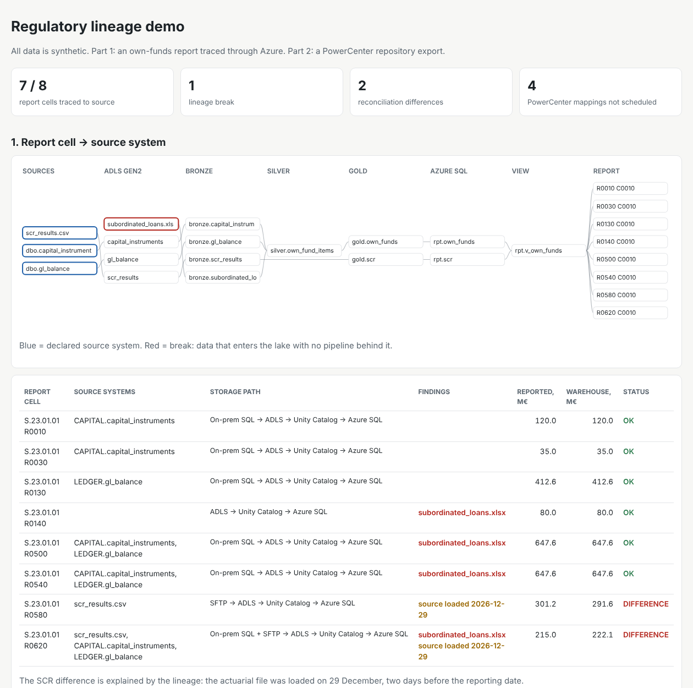

## What it shows

| Question | How the demo answers it |
| --- | --- |
| Where does this reported number come from? | Builds one graph from Data Factory pipelines, Unity Catalog table and column lineage, SQL view definitions and the report mapping, then walks it at column level from each report cell to the source tables. |
| Is there data in the chain that nobody loads? | Flags *breaks*: objects with no known load that are not declared sources. In the demo, a hand-uploaded spreadsheet feeds subordinated liabilities. |
| Why does the report differ from the warehouse? | Reconciles each cell and uses the load timestamps on the lineage path to explain the gap. In the demo, the SCR comes from an actuarial file loaded two days before the reporting date. |
| What does a PowerCenter estate actually contain? | Lists mappings with sources, targets and logic steps, follows table lineage across mappings and lists mappings no workflow runs. |

## Run it

Python 3.10 or later. No third-party packages are needed for the demo; the tests use pytest and
the code style is checked with ruff (settings in `pyproject.toml`).

```
python demo.py              # writes out/report.html and out/summary.json
python -m pytest -q         # 9 checks
ruff check . && ruff format --check .
```

Or without installing anything: open **Actions → tests → Run workflow** on GitHub. When the run finishes, download **demo-report** from the run page and open `report.html`.

## dbt example: from raw orders to an answer

`dbt/` is a small dbt project on DuckDB with synthetic orders of a fictional tool wholesaler. It answers the
question *"List countries by sales, and where were the most drills sold, in units and euros?"* and shows
the pieces that make such an answer trustworthy:

| Piece | Where |
| --- | --- |
| Layers: staging → intermediate → marts | `dbt/models/` |
| Sources with a freshness check on the raw orders | `dbt/models/staging/_sources.yml` |
| Tests: unique, not_null, relationships, accepted_values | `_staging.yml`, `_intermediate.yml`, `_marts.yml` |
| Reconciliation test: the mart total equals the fact table, to the cent | `dbt/tests/assert_mart_reconciles_to_fact.sql` |
| Currency rule written down once: euros at the order-date rate | `int_order_lines_eur.sql`, mart description |
| Incremental fact table (reloads the last 7 days of orders) | `fct_order_lines.sql` |
| Customer history (SCD type 2) | `dbt/snapshots/snap_customers.sql` |
| Metadata for natural-language querying: synonyms, example questions, owner, personal-data tag | `meta:` in `_marts.yml` and `_staging.yml` |
| A planted problem: four order lines refer to a product that does not exist | reported as a warning by the relationships test |

Run it (Python 3.10+):

```
pip install "dbt-duckdb>=1.10"
cd dbt
python generate_seeds.py          # optional: the CSVs are already in seeds/
dbt seed --profiles-dir .         # land the raw CSVs (stands in for ingestion)
dbt build --profiles-dir . --exclude "resource_type:seed"
```

See `dbt/README.md` for the layers and the decisions written down in the project.

The **dbt** job in GitHub Actions runs the same steps, prints the answer and uploads the dbt documentation
as the **dbt-docs** artifact. Expected answer, delivered orders in euros:

| Country | Drills, units | Drills, EUR | All sales, EUR |
| --- | ---: | ---: | ---: |
| Finland | 1 883 | 334 067 | 747 530 |
| Germany | 904 | 160 176 | 426 721 |
| Netherlands | 746 | 139 054 | 261 013 |
| Sweden | 467 | 82 670 | 191 520 |
| United States | 482 | 81 299 | 210 568 |
| Estonia | 176 | 29 274 | 76 804 |

## Migration example: a PowerCenter mapping in dbt

A synthetic HR mapping, `m_LOAD_DIM_EMPLOYEE`, loads an employee dimension with a filter, two
expressions, a department lookup, a sequence key and insert-or-update. The example moves it to dbt and
shows how to know the move is right:

| Step | Where |
| --- | --- |
| The export: mapping, workflow, parameter, and an old unscheduled copy | `samples/powercenter/HR_DEMO_export.xml` |
| The 14 rules read from the export (`Mapping.rules`) | `powercenter/parser.py` |
| Conversion record: each rule, its dbt line, and decisions D1–D6 with who decides | [`migration/m_LOAD_DIM_EMPLOYEE.md`](migration/m_LOAD_DIM_EMPLOYEE.md) |
| The dbt models, each rule commented with the mapping object it replaces | `dbt/models/*/hr/` |
| Data problems found by tests and left as warnings: missing types and FTEs, an unknown department, two active rows for one department | `dbt/models/staging/hr/_hr_staging.yml` |
| Parallel run: the model against the legacy table, every business column, both directions | `dbt/tests/assert_dim_employee_matches_legacy.sql` |
| Checks that no rule and no decision is left out | `tests/test_migration.py` |

The rule followed throughout: same result first, improvements after the cutover. In CI the parallel run
finds no differences in 138 rows. The legacy table is simulated here; in a real migration it is an unload
of the old warehouse table for the same reporting date.

## From the full toolkit (screenshots)

The repository holds a reduced, open version of the tools. Six views from the full toolkit, all on synthetic data; the toolkit's own user interface is in Finnish.

**PowerCenter dependency map.** Built from a repository export: mappings are coloured by complexity class (A–D), dashed outlines mark mappings that no session runs, dashed lines are lookup and SQL dependencies, and red dots mark findings. The chain runs from source tables through staging and the fact table to the LCR report.

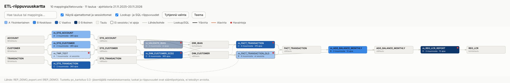

**Metadata editor.** Proposals made by machine (red, with confidence and evidence) wait for a person to accept them. The chosen role limits what can be approved: relationships by the data modeller, descriptions by the data steward, sensitivity by data protection and currency rules by finance. Every change is logged, and the result is exported as YAML for the semantic layer.

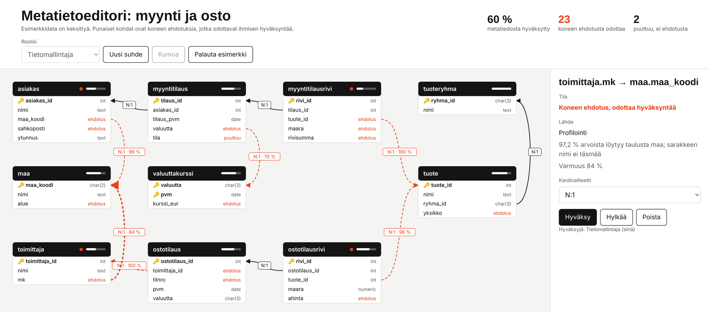

**Run map.** Built from the export together with parameter files, shell scripts, crontab and Workflow Monitor logs: cron → script → workflow → worklet → session → mapping, with parameter overrides and the files and tables that commands touch. Selecting a node highlights its chain and shows its settings, connections, the latest run from the logs and its findings (here a missing parameter file, a hard-coded password in a script and a writer thread that is the bottleneck).

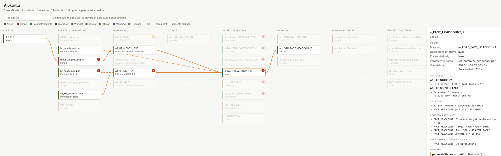

**From a Router mapping to dbt.** Each target of the mapping gets its own dbt model; the Router group's condition becomes the `where` clause, and the default group is "no other group matched". Rows the old Update Strategy rejected are left out, and the session log's reject count is the cross-check. Every draft is compared row by row with the legacy table on SQLite, DuckDB and Databricks.

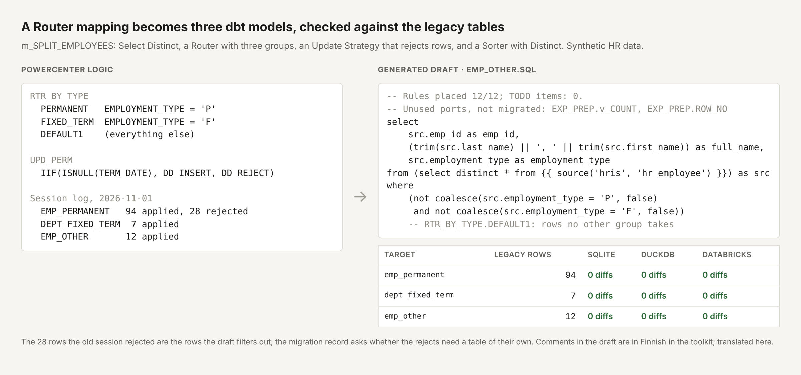

**From a workflow to a Databricks job.** Worklets become jobs of their own, sessions become dbt tasks, links become dependencies, the Event-Wait becomes a file-arrival trigger and the failure e-mail becomes a job notification. Commands get placeholders, and anything that needs a decision is listed instead of guessed.

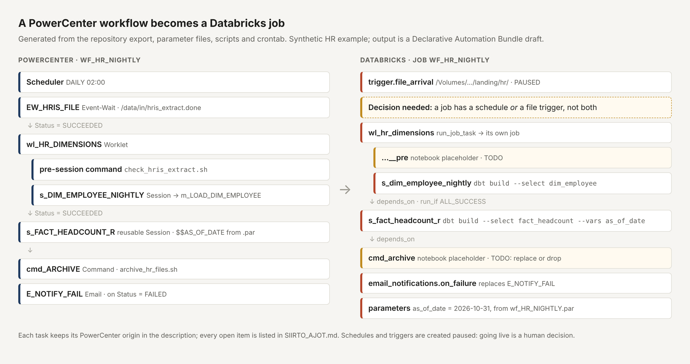

The same job deployed to a Databricks Free Edition workspace with `databricks bundle deploy`: the worklet runs as its own job, the session as dbt, and the archive command waits as a placeholder. The Router job from the previous example was run there too, and its parity tests passed.

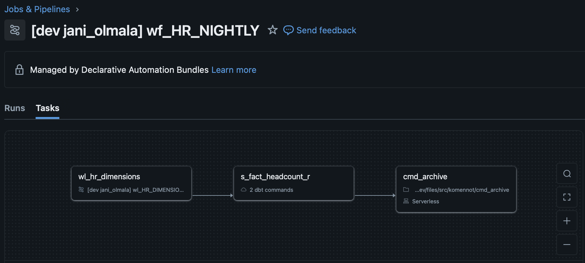

**The whole chain running in Databricks.** The PowerCenter shell commands became notebooks: a Python/PySpark check of the incoming extract (done marker, header, row count, unique key) replaces `check_hris_extract.sh`, and an archiving notebook replaces `archive_hr_files.sh` (move to an archive volume with a retention period; gzip and sftp are no longer needed). The nightly job then runs end to end on serverless compute.

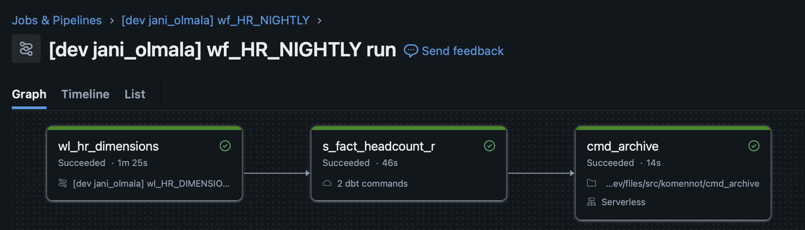

**Parity by column, not just by count.** A PySpark notebook compares the legacy table with the new model by key and by column, and logs every comparison to a table. Before decision D3, `dim_employee` had 38 extra rows that differed only in `dept_name` and `cost_center`: the department lookup matched two active rows. After D3 (latest valid department row) the tables match. The summary is plain SQL, so the same query works in the SQL editor or a dashboard.

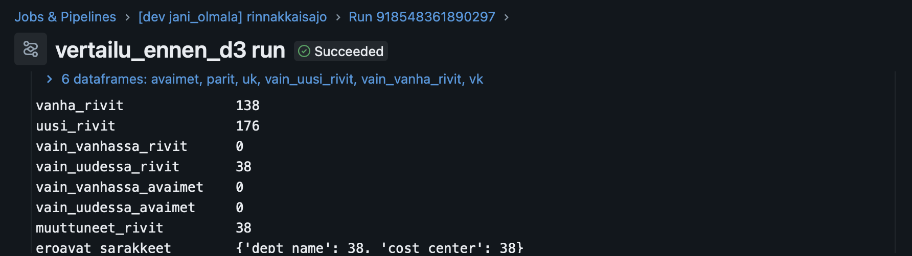

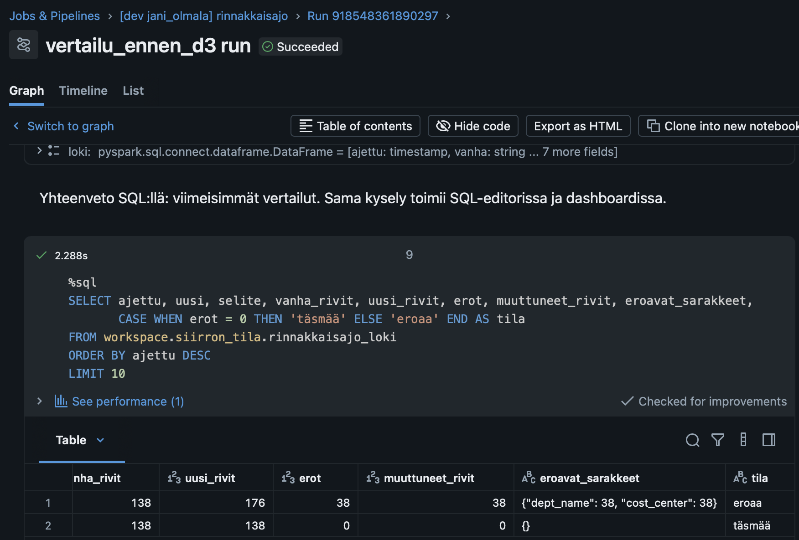

**The report on top, reconciled too.** A Power BI semantic model is generated from the dbt descriptions (TMDL: the legacy and new tables, a shared department table and the measures), and the page is built by hand in Power BI Desktop. Headcount and FTE match the legacy figures in every department. The second table shows what a report on the unreviewed draft would have shown: 176 employee rows instead of 138, all of the extra rows in one department, the one with two active department rows.

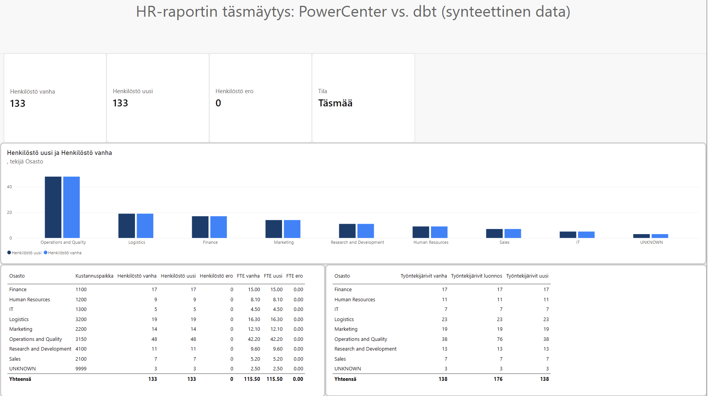

## Layout

```
lineage/graph.py        parsers for ADF, Unity Catalog lineage, SQL views, report mapping; the lineage graph
lineage/sample.py       synthetic extracts for a fictional insurer's own-funds report
powercenter/parser.py   minimal PowerCenter XML export reader: tables, rules, workflows
samples/powercenter/    synthetic repository exports (a bank DW and an HR mapping)
migration/              conversion record for the HR mapping
demo.py                 runs both parts and writes the HTML report
pyproject.toml          pytest and ruff settings
dbt/                    dbt project: synthetic orders and the HR migration, models, tests, snapshot
tests/                  checks on parsing, column-level tracing, breaks and reconciliation
docs/                   screenshots, AI working method, agent governance model
```

## Using it on a real platform

The inputs are metadata extracts, not data:

- Data Factory: an ARM export or `az datafactory pipeline show` output, reduced to datasets and Copy activities.
- Unity Catalog: `system.access.table_lineage` and `system.access.column_lineage` as CSV.
- SQL views: `sys.sql_modules` definitions.
- Report mapping: cell to view column, from the reporting tool.

Only object names and timestamps are read. Figures for reconciliation come from the report and the warehouse at the same reporting date.

## Scope

This is a reduced, illustrative version. The classification rules, effort estimates, SSIS and Databricks analysis, EBA and Solvency II taxonomy handling, and run-history analysis used in client work are not included.

## How it was built

Written with Claude Code as a pair programmer. Every module has a test, the expected results were defined before the code, and output was checked against the synthetic reference data. See [docs/how-ai-was-used.md](docs/how-ai-was-used.md).

## Governed AI agents

The same discipline applies to agents that run unattended. [docs/agent-governance.md](docs/agent-governance.md) describes the control model of a personal market-monitoring system: read-only access, no credentials for agents, scoped and version-checked writes, signed prompts, and a person for anything irreversible. It includes a synthetic example run. The system's code is not published.

## Author

Jani Olmala, Joindata Oy, Oulu, Finland · [LinkedIn](https://www.linkedin.com/in/jani-olmala-0a02788/)

© 2026 Joindata Oy. No open-source licence is granted; you are welcome to read and run the code to evaluate it.
